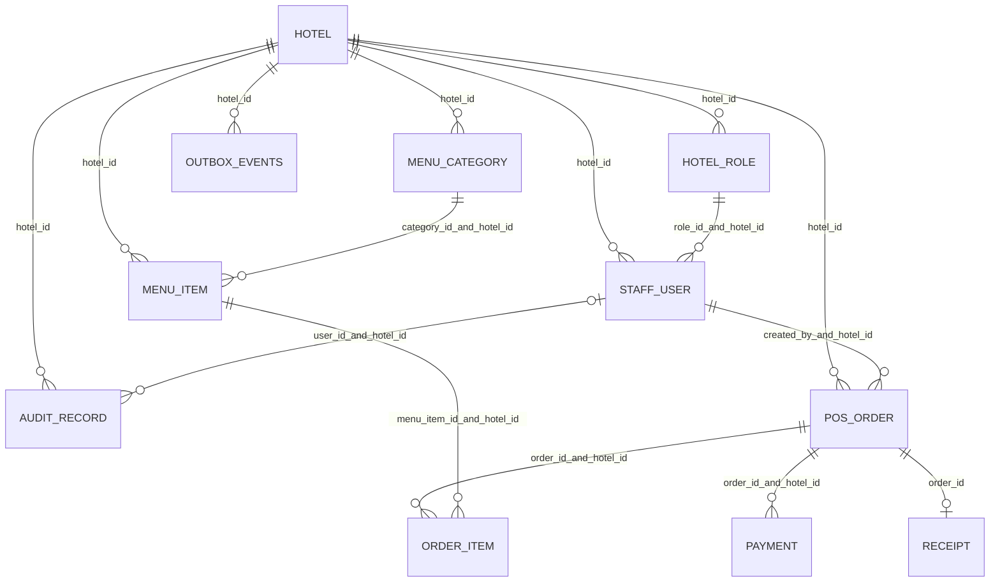

# URQR Hotel POS Entities and Relationships

This document describes the active hotel-owned JPA model after Flyway migration V11. The old tenant tables and their JPA mappings were removed. Hotel-owned rows use `hotel_id`; the transactional outbox is JDBC-managed and also uses `hotel_id`.

## Entities

### `Hotel` — table `hotel`

- `id: UUID`
- `name: String`
- `currencyCode: String`
- `timezone: String`
- `dayCutoff: LocalTime`
- `status: String`
- `receiptDetails: Map<String, Object>` — JSONB
- `createdAt: Instant`

### `Role` — table `hotel_role`

- `id: UUID`
- `hotelId: UUID`
- `hotel: Hotel` — association through `hotel_id`
- `name: String`

### `StaffUser` — table `staff_user`

- `id: UUID`
- `hotelId: UUID`
- `username: String`
- `passwordHash: String`
- `roleId: UUID`
- `roleEntity: Role` — association through `(hotel_id, role_id)`
- `status: String`
- `createdAt: Instant`

### `AuditRecord` — table `audit_record`

- `id: UUID`
- `hotelId: UUID`
- `hotel: Hotel` — association through `hotel_id`
- `userId: UUID` — nullable
- `user: StaffUser` — association through `(hotel_id, user_id)`
- `action: String`
- `entity: String`
- `entityId: String` — nullable
- `oldValue: String` — nullable
- `newValue: String` — nullable
- `createdAt: Instant`

### `MenuCategory` — table `menu_category`

- `id: UUID`
- `hotelId: UUID`
- `hotel: Hotel` — association through `hotel_id`
- `name: String`
- `active: boolean`

### `MenuItem` — table `menu_item`

- `id: UUID`
- `hotelId: UUID`
- `categoryId: UUID`
- `category: MenuCategory` — association through `(hotel_id, category_id)`
- `name: String`
- `price: BigDecimal`
- `available: boolean`
- `active: boolean`
- `cgstRate`, `sgstRate`, `vatRate`, `discountPercent: BigDecimal`

### `Order` — table `pos_order`

- `id: UUID`
- `hotelId: UUID`
- `hotel: Hotel` — association through `hotel_id`
- `orderNumber: String`
- `creator: StaffUser` — association through `(hotel_id, created_by)`
- `status: OrderStatus`
- `paymentStatus: PaymentStatus`
- `subtotal`, `discountTotal`, `taxTotal`, `grandTotal: BigDecimal`
- `createdBy: UUID`
- `cancelReason: String` — nullable
- `createdAt`, `updatedAt: Instant`

### `OrderItem` — table `order_item`

- `id: UUID`
- `hotelId: UUID`
- `orderId: UUID`; `order: Order` — association through `(hotel_id, order_id)`
- `menuItemId: UUID`; `menuItem: MenuItem` — association through `(hotel_id, menu_item_id)`
- `nameSnapshot: String`
- `priceSnapshot`, `discountAmount`, `taxCgst`, `taxSgst`, `taxVat`, `lineTotal: BigDecimal`
- `quantity: int`

### `Payment` — table `payment`

- `id: UUID`
- `hotelId: UUID`
- `orderId: UUID`
- `order: Order` — association through `(hotel_id, order_id)`
- `method: PaymentMethod`
- `amount: BigDecimal`
- `referenceNo: String` — nullable
- `createdAt: Instant`

### `Receipt` — table `receipt`

- `id: UUID`
- `hotelId: UUID`
- `orderId: UUID`
- `order: Order` — association through `(hotel_id, order_id)`
- `receiptNumber: String`
- `snapshot: Map<String, Object>` — JSONB
- `createdAt: Instant`

## Relationships

The outbox has no JPA entity. It is written in the same transaction as POS order changes and published asynchronously. Row-level security uses the transaction-local `app.hotel_id` setting, populated from the authenticated `hotel_id` claim.
