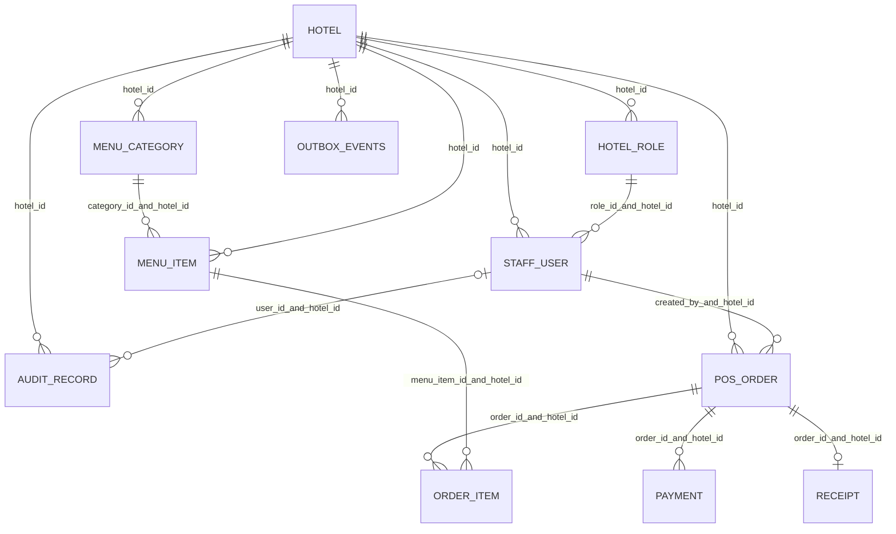

# URQR Hotel POS Entities and Relationships

This document describes the hotel-owned JPA model and supporting database tables after Flyway migrations through V14. The `Hotel.id` and every `hotel_id` column are strings (up to 64 characters). Staff, audit, category, menu item, order, order item, payment, and receipt identifiers are formatted strings (up to 96 characters). `Role.id` and outbox `event_id` remain UUIDs. Hotel data is isolated by `hotel_id` using PostgreSQL row-level security.

## Entities

### `Hotel` — table `hotel`

- `id: String` — generated public hotel code, up to 64 characters
- `name: String`
- `currencyCode: String`
- `timezone: String`
- `dayCutoff: LocalTime`
- `status: String`
- `receiptDetails: Map<String, Object>` — JSONB
- `createdAt: Instant`

### `Role` — table `hotel_role`

- `id: UUID`
- `hotelId: String`
- `hotel: Hotel` — association through `hotel_id`
- `name: String`

### `StaffUser` — table `staff_user`

- `id: String` — `MGR`, `CSR`, `COOK`, or `WTR` + first three hotel-name letters + sequence
- `hotelId: String`
- `username: String`
- `passwordHash: String`
- `roleId: UUID`
- `roleEntity: Role` — association through `(hotel_id, role_id)`
- `status: String`
- `createdAt: Instant`

### `AuditRecord` — table `audit_record`

- `id: String` — `ADT` + first three hotel-name letters + UTC date + sequence
- `hotelId: String`
- `hotel: Hotel` — association through `hotel_id`
- `userId: String` — nullable staff ID
- `user: StaffUser` — association through `(hotel_id, user_id)`
- `action: String`
- `entity: String`
- `entityId: String` — nullable
- `oldValue: String` — nullable
- `newValue: String` — nullable
- `createdAt: Instant`

### `MenuCategory` — table `menu_category`

- `id: String` — `CAT` + first three hotel-name letters + sequence
- `hotelId: String`
- `hotel: Hotel` — association through `hotel_id`
- `name: String`
- `active: boolean`

### `MenuItem` — table `menu_item`

- `id: String` — first three category-name letters + first three hotel-name letters + sequence
- `hotelId: String`
- `categoryId: String`
- `category: MenuCategory` — association through `(hotel_id, category_id)`
- `name: String`
- `price: BigDecimal`
- `available: boolean`
- `active: boolean`
- `cgstRate`, `sgstRate`, `vatRate`, `discountPercent: BigDecimal`

### `Order` — table `pos_order`

- `id: String` — first three hotel-name letters + UTC date + sequence
- `hotelId: String`
- `hotel: Hotel` — association through `hotel_id`
- `orderNumber: String`
- `creator: StaffUser` — association through `(hotel_id, created_by)`
- `status: OrderStatus`
- `paymentStatus: PaymentStatus`
- `subtotal`, `discountTotal`, `taxTotal`, `grandTotal: BigDecimal`
- `createdBy: String` — staff ID
- `cancelReason: String` — nullable
- `createdAt`, `updatedAt: Instant`

### `OrderItem` — table `order_item`

- `id: String` — `OI` + first three hotel-name letters + sequence
- `hotelId: String`
- `orderId: String`; `order: Order` — association through `(hotel_id, order_id)`
- `menuItemId: String`; `menuItem: MenuItem` — association through `(hotel_id, menu_item_id)`
- `nameSnapshot: String`
- `priceSnapshot`, `discountAmount`, `taxCgst`, `taxSgst`, `taxVat`, `lineTotal: BigDecimal`
- `quantity: int`

### `Payment` — table `payment`

- `id: String` — payment method + first three hotel-name letters + UTC date + sequence
- `hotelId: String`
- `orderId: String`
- `order: Order` — association through `(hotel_id, order_id)`
- `method: PaymentMethod`
- `amount: BigDecimal`
- `referenceNo: String` — nullable
- `createdAt: Instant`

### `Receipt` — table `receipt`

- `id: String` — `RPT` + first three hotel-name letters + UTC date + sequence
- `hotelId: String`
- `orderId: String` — unique per receipt record
- `order: Order` — association through `(hotel_id, order_id)`
- `receiptNumber: String`
- `snapshot: Map<String, Object>` — JSONB
- `createdAt: Instant`

## Relationships

The `outbox_events` table has no JPA entity; application code writes and claims events with JDBC in the same transaction as order changes. It stores `event_id`, `hotel_id`, aggregate and event details, JSONB payload, delivery state, retry metadata, and timestamps. Row-level security uses the transaction-local `app.hotel_id` setting, populated from the authenticated hotel claim. Order request idempotency is stored in Redis and is not a relational entity.
